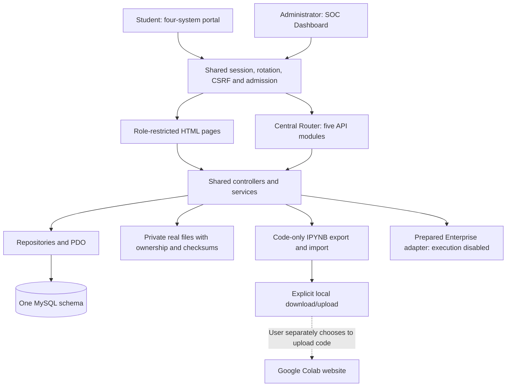

# V10 architecture and Colab boundaries

The platform remains one plain-PHP application, one shared MySQL/MariaDB schema accessed through native PDO, four student systems and one central administrative SOC. Existing controllers, services, repositories, authentication/CSRF, five route modules, private files and the approved design system are retained. No Laravel, browser cookie scraper, second backend or per-system database is introduced.

## Application structure

SystemAccess enforces the page-role boundary on the server. STUDENT enters index.php and sees only Systems1–4; ADMIN enters SOC Dashboard and uses SOC for administration. API object privileges remain in their original role/ownership services. Administrator inspection does not change student authorship. [Detailed role matrix](V10_ROLE_ACCESS_MATRIX.md).

## Current Colab integration

No Google Cloud project is configured for this installation. The current user-facing integration is **manual notebook code exchange** with Google Colab. The official Enterprise request adapter is prepared, while Google execution, automatic dataset transfer, trusted quality evaluation and inference serving remain disabled.

The ML editor provides Download for Colab, an ordinary `https://colab.research.google.com/` link and explicit code import. The link includes no notebook content, credentials or dataset URL. The user saves, downloads the owned saved IPYNB and separately chooses what to upload to Google. Downloading does not upload code, call a runtime or authorize data sharing. The UI explains that data may be shared only when the user has appropriate permission.

`NotebookDocument` emits IPYNB version4 with code/markdown source and clean Python kernel metadata. Exported code cells have empty outputs and null execution counts; application/provider credentials and notebook-specific metadata are not added. Imports accept a real uploaded .ipynb, valid UTF-8 JSON, at most2MiB, up to200 code/markdown cells and up to256KiB source per cell. Code source may be a string or an ordered string list. Unsupported cell types are rejected. Outputs, execution counts, attachments, arbitrary metadata and ownership/provenance assertions are discarded.

Import is an explicit authenticated CSRF-protected POST that creates a **new** student-owned notebook through NotebookService. Assigned ticket references are validated by the existing WorkOwnership rules. Existing notebooks are not silently replaced. Cells and audit events persist transactionally in MySQL; navigation creates no work. Imported results never become trusted runtime output or quality evidence. Administrators inspect/export original notebooks through SOC, rather than creating work as the student.

The file exchange endpoints are part of the existing workbench module, including compatibility aliases; the SOC export alias retains the central administrator gate. Export uses a generated attachment filename, no-store and nosniff headers. Neither downloaded notebook output nor a student-written accuracy claim is independent evaluation evidence.

## Prepared provider boundary

`ExecutionProvider` is a small interface for availability, submission and cancellation. `ColabEnterpriseProvider` prepares the documented Enterprise notebookExecutionJobs create request offline: regional aiplatform endpoint, configured runtime template, directNotebookSource, explicit execution timeout, student-specific execution service account, distinct student/job Cloud Storage prefix and stable resource ID. Preparation is not transmission, provisioning or an authorization grant.

Availability always reports `can_execute=false` and PREPARED_NOT_LIVE_VERIFIED. Absent configuration reports NOT_CONFIGURED; invalid configuration reports INVALID; structurally present configuration reports PENDING_VERIFICATION. Credentials or environment settings alone cannot activate execution. Submission and cancellation throw explicit unavailable errors. Existing HTTP execution requests still validate authentication/ownership and return503; no success job, host subprocess or provider result is fabricated.

The Enterprise reference documents create/get/list/delete, without a verified notebook-execution cancel method. DELETE is not treated as proof that arbitrary running code stopped. Existing saved local cancellation history is explicitly separate from remote termination; no Google-backed cancellation result is claimed. There is no HTTP provider-probe or user-controlled URL adapter.

## Credential and transport preparation

`COLAB_CONFIG_FILE` points to an explicit private JSON file outside source/webroot. GoogleOAuthCredentials reads an explicit bounded private credential file and supports validated authorized-user refresh credentials or service-account JWT token exchange. Tokens are refreshed ahead of expiry and cached only in that object's memory. Refresh errors are sanitized; no disk bearer-token cache, metadata-service discovery, frontend token injection or browser cookie scraping is used. A future production identity should be chosen and reviewed independently; this implementation does not claim workload identity or federated credential support.

GoogleHttpTransport permits bounded HTTPS requests only to its reviewed Google endpoint families. It validates URL/header shapes, verifies TLS, refuses redirects/proxies and bounds request/response size and connection/overall deadlines. These transport contracts do not establish account eligibility, runtime isolation or IAM correctness.

`bin/colab_preflight.php` is CLI-only and normally prints the truthful unavailable state. The explicit `--probe-google` option may refresh operator-provided credentials and read the configured runtime template. It creates no runtime/job and transfers no notebook/dataset. Even a successful authenticated template read leaves execution disabled and returns no live-execution acceptance. The CLI exits78 while unavailable. SOC's provider-inspection endpoint exposes sanitized availability only, never credentials or private configuration paths.

## Required remote execution work

Google's ordinary Colab REST runtime APIs, MCP execute_code and Colab Enterprise are distinct documented services. The researched preferred centrally managed direction is Enterprise execution jobs; ordinary MCP sessions are not assumed to isolate files between students. [Official contracts, limitations and links](V10_COLAB_RESEARCH.md).

Before activation, an authorized operator must supply a Google project/region, APIs, reviewed credential/IAM model, accepted billing/quotas and restricted runtime template. Separate execution identities and input/output permissions must prevent access to application secrets, SQL, orchestration credentials and other students' data. Public internet/end-user credential defaults cannot be accepted without review. Actual student filesystem/network/metadata/IAM denials, bounded resources, timeouts, cleanup and cancellation behavior require provider-backed tests.

Future job persistence must bind an immutable notebook/dataset snapshot, owner/ticket, input hashes, actual provider resource, raw provider state and retained results. Ambiguous submission/timeouts require reconciliation rather than blind retries or invented COMPLETED/CANCELLED status. Actual output must be retrieved through bounded private reads, encoded as untrusted text and retain truncation/error information. None of these future cloud-result paths is represented as working by manual import.

Trusted model evaluation additionally needs an independently controlled evaluator and evidence bound to real artifact/dataset versions. Student-controlled notebook metrics remain USER_REPORTED even if a cloud runtime executed the code. Deployment needs a real isolated serving provider, measured status and authentic endpoint; approving a database request is not deployment. Both capabilities remain unavailable until independently implemented and accepted.

## Data and release preservation

V10 does not require a schema migration for code exchange or page-role separation. Notebook/cell ownership, existing edit versions, audit history, assignment checks and private artifacts remain in the shared schema. Main is not used for mutating tests or populated with student_test. Fresh/recovery helpers retain their no-reset/new-target guards. Source packaging excludes local configuration, history, dumps, private payloads, caches/logs/test output and secret files while retaining migrations/storage directories/access controls. The release is separate from a combined database/private-file backup.

Provider unit/contract tests validate local parsing, request construction and refusal behavior only. Actual Apache/MySQL tests and browser checks validate the application workflow in a separately configured testing tree. Neither category constitutes a live Google execution, isolation, evaluator or serving acceptance test. Final test counts and release readiness must be taken from the V10 verification report, not inferred from this architecture document.
