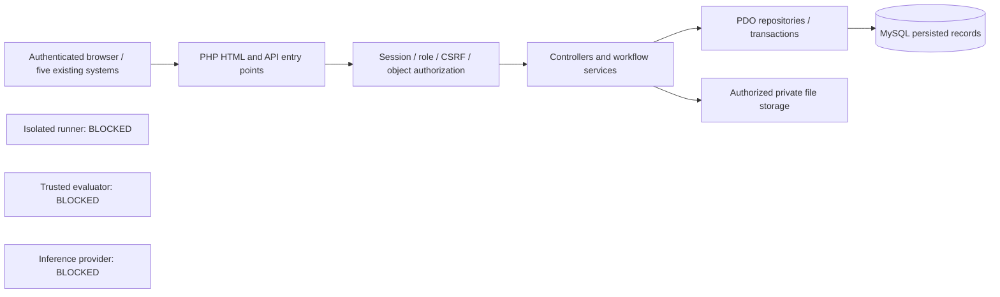

# V9 architecture and infrastructure assessment

Assessment date: 2026-11-01. The implementation is PHP without Laravel, MySQL/MariaDB through native PDO, existing PHP templates and shared JavaScript. The approved UI remains in place. Baseline is commit `309d92e` on `main`; the actual predecessor is V7, despite the supplied request's V8 label. See [baseline evidence](V9_BASELINE_REPORT.md).

## Application boundary

The five system directories retain their existing entry pages and presentation. The project `.htaccess` resolves system directory requests to `Dashboard.php` or `dashboard.php`; the root retains `index.php`. `OperationsDashboard.php` has one canonical SOC dashboard redirect. `AppUrl` supplies the installed prefix rather than assuming `/api` lives at the server root.

`app/bootstrap.php` loads environment configuration, the local autoloader, session and response policy, validates production settings, checks same-origin writes, and protects HTML form mutations. `api/v1/index.php` runs CSRF middleware and registers the shared router. Five API module files describe project, data, workbench, registry and SOC contracts. Controllers validate requests, services enforce workflow and object ownership, and repositories issue parameterized queries. `Database::execute(sql, params)` handles explicit SQL; `insert(table, data)` validates identifiers and constructs an insert. The former SQL-as-table compatibility is absent.

The disconnected boxes describe missing infrastructure, not running integrations. No application flag or administrator approval enables these capabilities.

## Roles, lifecycle and persistence

`ADMIN` manages students, scenarios, tickets, assignments, master datasets, workspace oversight and submission reviews. `STUDENT` sees authorized assigned work and their own processed uploads, notebooks, experiments, models and submissions. Authentication checks active status and the database session generation. Password rotation increments that generation and invalidates other sessions. No public student registration exists. The local first-install administrator must rotate its password; the `admin` development password requires explicit local configuration plus loopback client/server and host checks and rejects forwarding headers.

Scenario builder metadata is persisted in MySQL JSON and accessed through authenticated CRUD. Ticket assignment, student progress, processed data ownership, notebook/cell saves, model registration and submission review are explicit mutations. A GET renders persisted state; it does not seed records, notebooks or cells. Dashboard counts are database aggregates. `SocSystemService::health` measures a live PDO `SELECT 1` round trip and describes application availability only for the completed request. It explicitly returns `NOT_CONFIGURED` for the worker, evaluator and inference provider.

Uploaded datasets, processed datasets and optional real model artifacts remain files under private storage with database ownership, version and checksum references. Dataset parsing derives row/schema information from the uploaded file. Registered model metadata does not invent an artifact version. The HTTP server denies direct access to `storage`, application internals, migration files, tools, tests, verification evidence, dependencies and Git history. Authenticated download handlers authorize related records. Release packaging omits private runtime payloads without deleting originals or future uploads.

## Execution, evaluation and serving: observed state

The actual host inventory is in `verification/v9-20261101/isolation-inventory.json` and command results in `isolation-platform-baseline.json`:

| Observation | Result |
|---|---|
| Host | Windows 11, NT 10.0.26300.0; 24 logical processors; 34,190,057,472 bytes physical memory |
| Docker / Podman / kubectl / nerdctl | Not found on PATH; checked Docker and Podman installation paths also absent |
| Docker / vmcompute / hns / WSL / vmms services | Not installed in the inspected service inventory |
| WSL executable | Present; `wsl --status` exit 50 and `--list --quiet` exit 1 explicitly report WSL not installed |
| VirtualMachinePlatform / WSL / Hyper-V optional features | `InstallState = 2`, disabled |
| Reviewed isolated service, independent identity, verified resource/network policies | No deployed integration or acceptance evidence |

The reported hypervisor-present flag is true. Firmware/SLAT inventory flags were false; these observations do not establish whether the machine could support a future installation. CPU/RAM capacity and an executable's presence do not establish workload isolation. No daemon, VM, student source or uploaded model was started. No Windows feature, service, network or credential configuration was changed.

`ExecutionService::submitJob` checks notebook ownership then rejects execution as unavailable. The retired worker is a nonexecuting stub: `python workers/python_worker.py` returned exit **78**, with “Execution unavailable: no verified isolated runner is deployed.” Job cancellation changes authorized queue metadata atomically and records that runtime termination is unavailable; it does not claim an unverified process was killed.

`ValidationService` checks that the genuine artifact file is nonempty and its SHA-256 matches the stored upload record. That is an integrity result only. Reports retain `NOT_EVALUATED`, null quality scores, `NO_TRUSTED_EVALUATOR`, and incomplete quality checks. Student metrics do not establish quality. Uploaded pickle/joblib or other opaque artifact bytes are never deserialized by PHP or this assessment.

`DeploymentService` stores and reviews deployment requests. `PENDING`, `APPROVED` and `REJECTED` describe administrative decisions. The provider remains `NOT_CONFIGURED`, `deployed = false`, endpoint URL null, and verified deployments empty. Approval does not create inference traffic, latency measurements or an endpoint.

## Conditions for a future service

Provisioning requires an operator-selected supported platform and separate deployment review. A dedicated patched Linux VM with a reviewed workload isolation layer is one feasible design; it has not been provisioned or verified here. Containers alone need careful namespace, resource and daemon-access controls. Docker documents the privileged daemon attack surface and the risk of giving a web application control over container options or host mounts. The PHP service must never receive a Docker socket or equivalent unrestricted control channel. [Docker security documentation](https://docs.docker.com/engine/security/)

Rootless operation can reduce privileges but is not, by itself, proof that resource limits, filesystem boundaries or network restrictions are correct. A stronger workload boundary such as gVisor or a VM still needs deployment-specific tests. [Docker rootless documentation](https://docs.docker.com/engine/security/rootless/), [gVisor architecture](https://gvisor.dev/docs/architecture_guide/intro/)

Before activation, independently demonstrate all of the following:

1. Separate restricted service identities; no `.env`, application DB credentials, host control socket or writable application source in a workload.
2. Per-student scratch filesystem, read-only explicitly authorized inputs, bounded outputs and cleanup after completion, timeout, crash and cancellation.
3. Deny-by-default egress, no access to private infrastructure or another student's artifacts, and authenticated short-lived authorized transfers.
4. Enforced CPU, RAM, process count, wall time, output bytes and storage quotas, including fork/memory/output pressure tests.
5. Authenticated job transport, atomic claim/lease and retry behavior, replay protection, cancellation acknowledgement, failure recovery and auditable state history.
6. Real service health measurements; saved notebooks remain usable when the external service is unavailable.
7. Trusted evaluator code/image identity, hidden assigned holdout data, artifact/dataset checksums, evaluator version, parameters, timestamps and provenance bound to a result. Student-reported metrics stay separate.
8. Serving identity and artifact authorization; actual authenticated health and inference checks, stop/rollback verification, ownership limits and endpoint publication only after success.

Installing WSL would require enabling Windows features and can require an administrator restart, so it was not attempted during application stabilization. [Microsoft WSL installation documentation](https://learn.microsoft.com/en-us/windows/wsl/install)

`python bin/infrastructure_preflight.py` is a repeatable, read-only inventory. It launches no external executable, emits no credentials, and deliberately returns **78**. Even if all listed tools are later found, it continues to report the services disabled until a reviewed adapter and acceptance tests exist. Six deterministic tests verify these truthful disabled conditions; they are not sandbox acceptance tests.

## Source audit and verification limits

`bin/audit_source.py` inventories `.php`, `.js`, `.mjs`, `.cjs`, `.sql` and `.py`, including retained private source as text. It records path, size and SHA-256, never executes/imports target files and never connects to a database. Required categories are ACTIVE APPLICATION CODE, DEVELOPMENT TOOLS, TEST FILES, DEPENDENCIES, HISTORICAL MIGRATIONS and GENERATED ARTIFACTS. All findings remain in the JSON report; contextual categories are not deletion/exclusion instructions.

Unknown paths and test/vendor-looking names nested in application directories remain active. Migrations are inspected; the one exact existing-dataset metadata backfill is explained, while unfamiliar SQL data writes require review. Linked paths are not followed and active/migration gaps require review. UTF-8 failures in operational source require review. Reports use `source-audit-current.json` and `source-inventory-current.json` under protected verification storage, preserving historical evidence. Linked report destinations and application-directory output are refused.

Fifteen regression tests cover these boundaries, genuine operational pattern detection, redaction, source immutability, return codes and nonexecution. Pattern scanning cannot prove authorization, detect every secret, establish endpoint functionality or certify production security. It accompanies the independent HTTP/SQL/browser and history/dependency checks documented in the final test and security reports.
